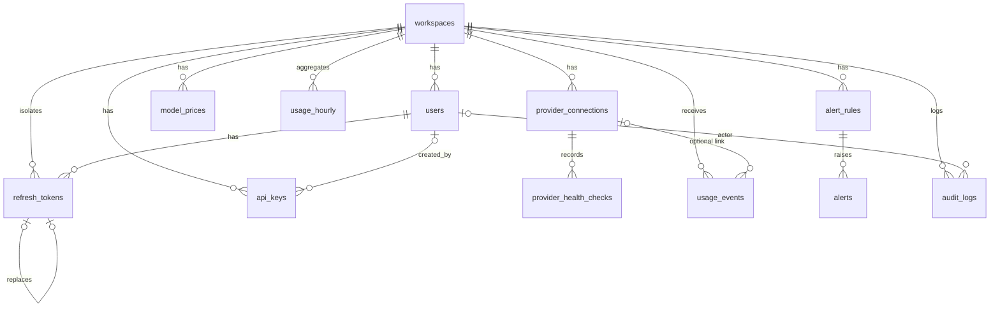

# Database Schema Design — Kestrel AI Control Center

## 1. Architectural Conventions

- **Naming Conventions**: All identifiers follow `snake_case`. Table names are pluralized nouns (`workspaces`, `users`, `usage_events`).
- **Primary Keys**:
  - `UUID` generated via server default `gen_random_uuid()` (PostgreSQL 13+ native, pgcrypto-independent) for tenant and configuration entities.
  - `BIGINT GENERATED ALWAYS AS IDENTITY` for high-volume, append-only time-series tables (`usage_events`, `provider_health_checks`, `audit_logs`).
- **Multi-Tenancy & Isolation**:
  - Every tenant entity mandates `workspace_id NOT NULL REFERENCES workspaces(id) ON DELETE RESTRICT`.
  - Tenant isolation is strictly enforced in the application repository layer. Row-Level Security (RLS) is deferred as a potential defense-in-depth hardening measure.
- **Timestamps**:
  - All timestamps use `TIMESTAMPTZ` stored in UTC.
  - Immutable rows define `created_at TIMESTAMPTZ NOT NULL DEFAULT now()`.
  - Mutable rows additionally define `updated_at TIMESTAMPTZ NOT NULL DEFAULT now()`.
- **Financial Precision**: Monetary amounts and token rates use `NUMERIC` with explicit scale and precision; floating-point types (`FLOAT`, `DOUBLE PRECISION`) are prohibited.
- **Enumerations**: Represented as `VARCHAR` columns with explicit SQL `CHECK` constraints (rather than native PostgreSQL enum types) to ensure zero-downtime alterations.
- **Index & Constraint Naming**: Enforced systematically via SQLAlchemy MetaData `naming_convention`:
  - Primary Key: `pk_%(table_name)s`
  - Unique Constraint: `uq_%(table_name)s_%(column_0_name)s`
  - Foreign Key: `fk_%(table_name)s_%(column_0_name)s_%(referred_table_name)s`
  - Check Constraint: `ck_%(table_name)s_%(constraint_name)s`
  - Index: `ix_%(column_0_label)s`
- **Data Privacy (ADR-008)**: Prompt text and model completion outputs are never stored anywhere in the schema. Secrets must never be stored inside `jsonb` details columns.
- **Reserved Identifier Policy**: No column may be named `metadata` due to declarative SQLAlchemy namespace reservations.

---

## 2. Entity-Relationship Diagram (ERD)

---

## 3. Table Catalog

| Table | Description | PK Strategy | Status |
|---|---|---|---|
| `workspaces` | Multi-tenant organizational units with budget & retention rules | UUID (`gen_random_uuid()`) | **Implemented (Migration 0001)** |
| `users` | User credentials and role-based permissions | UUID (`gen_random_uuid()`) | **Implemented (Migration 0001)** |
| `refresh_tokens` | DB-backed opaque refresh token hashes with rotation & reuse detection | UUID (`gen_random_uuid()`) | Planned (Milestone 5) |
| `api_keys` | Hashed ingestion credentials for external app telemetry | UUID (`gen_random_uuid()`) | Planned (Ingest Milestone) |
| `provider_connections` | Encrypted upstream LLM provider API credentials | UUID (`gen_random_uuid()`) | Planned (Providers Milestone) |
| `provider_health_checks` | Scheduled upstream provider latency and status history | BIGINT IDENTITY | Planned (Providers Milestone) |
| `model_prices` | Versioned model rate cards for input/output tokens | UUID (`gen_random_uuid()`) | Planned (Pricing Milestone) |
| `usage_events` | Granular client-reported LLM telemetry events | BIGINT IDENTITY | Planned (Ingest Milestone) |
| `usage_hourly` | Hourly pre-aggregated token, cost, and request summaries | Composite PK | Planned (Analytics Milestone) |
| `alert_rules` | Threshold conditions for latency, spend, and errors | UUID (`gen_random_uuid()`) | Planned (Alerts Milestone) |
| `alerts` | Deduplicated firing and resolved incident lifecycle | UUID (`gen_random_uuid()`) | Planned (Alerts Milestone) |
| `audit_logs` | Immutable audit trail for administrative operations | BIGINT IDENTITY | Planned (Audit Milestone) |

---

## 4. Table Definitions & Specifications

### 1. `workspaces`
Tenant boundary container.
- `id`: `UUID PRIMARY KEY DEFAULT gen_random_uuid()`
- `name`: `VARCHAR(120) NOT NULL`
- `slug`: `VARCHAR(63) NOT NULL UNIQUE`
- `retention_days`: `INT NOT NULL DEFAULT 30 CHECK (retention_days > 0)`
- `timezone`: `VARCHAR(64) NOT NULL DEFAULT 'UTC'`
- `monthly_budget_usd`: `NUMERIC(12, 2) NULL CHECK (monthly_budget_usd >= 0)`
- `created_at`: `TIMESTAMPTZ NOT NULL DEFAULT now()`
- `updated_at`: `TIMESTAMPTZ NOT NULL DEFAULT now()`
- **Status**: Implemented (`0001`)

### 2. `users`
User identity and workspace access roles.
- `id`: `UUID PRIMARY KEY DEFAULT gen_random_uuid()`
- `workspace_id`: `UUID NOT NULL REFERENCES workspaces(id) ON DELETE RESTRICT`
- `email`: `VARCHAR(320) NOT NULL UNIQUE CHECK (email = lower(email))`
- `password_hash`: `TEXT NOT NULL`
- `role`: `VARCHAR(16) NOT NULL CHECK (role IN ('admin', 'viewer'))`
- `is_active`: `BOOLEAN NOT NULL DEFAULT true`
- `last_login_at`: `TIMESTAMPTZ NULL`
- `created_at`: `TIMESTAMPTZ NOT NULL DEFAULT now()`
- `updated_at`: `TIMESTAMPTZ NOT NULL DEFAULT now()`
- **Indexes**: `ix_users_workspace_id` on `(workspace_id)`
- **Status**: Implemented (`0001`)

### 3. `api_keys`
Workspace-scoped API keys for telemetry ingestion.
- `id`: `UUID PRIMARY KEY DEFAULT gen_random_uuid()`
- `workspace_id`: `UUID NOT NULL REFERENCES workspaces(id) ON DELETE RESTRICT`
- `name`: `VARCHAR(120) NOT NULL`
- `key_prefix`: `VARCHAR(12) NOT NULL` (display only, e.g. `kst_live_`)
- `key_hash`: `CHAR(64) NOT NULL UNIQUE` (SHA-256 hex digest of client secret)
- `created_by_user_id`: `UUID NULL REFERENCES users(id) ON DELETE SET NULL`
- `created_at`: `TIMESTAMPTZ NOT NULL DEFAULT now()`
- `last_used_at`: `TIMESTAMPTZ NULL`
- `revoked_at`: `TIMESTAMPTZ NULL`
- **Indexes**: `ix_api_keys_workspace_id` on `(workspace_id)`
- **Status**: Planned

### 4. `provider_connections`
Credentials for upstream providers (Groq, Gemini, Ollama) encrypted at rest.
- `id`: `UUID PRIMARY KEY DEFAULT gen_random_uuid()`
- `workspace_id`: `UUID NOT NULL REFERENCES workspaces(id) ON DELETE RESTRICT`
- `name`: `VARCHAR(120) NOT NULL`
- `provider_type`: `VARCHAR(32) NOT NULL CHECK (provider_type IN ('openai_compatible', 'gemini'))`
- `base_url`: `TEXT NULL`
- `encrypted_credential`: `BYTEA NULL` (Fernet-encrypted token)
- `credential_last4`: `VARCHAR(4) NULL`
- `is_enabled`: `BOOLEAN NOT NULL DEFAULT true`
- `created_at`: `TIMESTAMPTZ NOT NULL DEFAULT now()`
- `updated_at`: `TIMESTAMPTZ NOT NULL DEFAULT now()`
- **Constraints**: `UNIQUE (workspace_id, name)`
- **Status**: Planned

### 5. `provider_health_checks`
Probe history for configured provider connections.
- `id`: `BIGINT GENERATED ALWAYS AS IDENTITY PRIMARY KEY`
- `workspace_id`: `UUID NOT NULL REFERENCES workspaces(id) ON DELETE RESTRICT`
- `provider_connection_id`: `UUID NOT NULL REFERENCES provider_connections(id) ON DELETE CASCADE`
- `checked_at`: `TIMESTAMPTZ NOT NULL`
- `status`: `VARCHAR(16) NOT NULL CHECK (status IN ('ok', 'degraded', 'down'))`
- `latency_ms`: `INT NULL`
- `error_type`: `VARCHAR(64) NULL`
- **Indexes**:
  - `(provider_connection_id, checked_at DESC)`
  - `(workspace_id, checked_at DESC)`
- **Status**: Planned

### 6. `model_prices`
Effective token rates per 1M tokens.
- `id`: `UUID PRIMARY KEY DEFAULT gen_random_uuid()`
- `workspace_id`: `UUID NOT NULL REFERENCES workspaces(id) ON DELETE RESTRICT`
- `provider`: `VARCHAR(64) NOT NULL`
- `model`: `VARCHAR(128) NOT NULL`
- `input_per_1m_usd`: `NUMERIC(18, 8) NOT NULL CHECK (input_per_1m_usd >= 0)`
- `output_per_1m_usd`: `NUMERIC(18, 8) NOT NULL CHECK (output_per_1m_usd >= 0)`
- `source_url`: `TEXT NOT NULL`
- `effective_from`: `DATE NOT NULL`
- `created_by_user_id`: `UUID NULL REFERENCES users(id) ON DELETE SET NULL`
- `created_at`: `TIMESTAMPTZ NOT NULL DEFAULT now()`
- **Constraints**: `UNIQUE (workspace_id, provider, model, effective_from)`
- **Status**: Planned

### 7. `usage_events`
High-volume append-only LLM invocation telemetry events.
- `id`: `BIGINT GENERATED ALWAYS AS IDENTITY PRIMARY KEY`
- `workspace_id`: `UUID NOT NULL REFERENCES workspaces(id) ON DELETE RESTRICT`
- `idempotency_key`: `VARCHAR(128) NULL`
- `occurred_at`: `TIMESTAMPTZ NOT NULL` (client-reported)
- `received_at`: `TIMESTAMPTZ NOT NULL DEFAULT now()`
- `app_name`: `VARCHAR(120) NOT NULL`
- `provider`: `VARCHAR(64) NOT NULL`
- `provider_connection_id`: `UUID NULL REFERENCES provider_connections(id) ON DELETE SET NULL`
- `model`: `VARCHAR(128) NOT NULL`
- `input_tokens`: `INT NOT NULL CHECK (input_tokens >= 0)`
- `output_tokens`: `INT NOT NULL CHECK (output_tokens >= 0)`
- `total_tokens`: `INT NOT NULL CHECK (total_tokens >= 0)`
- `token_source`: `VARCHAR(16) NOT NULL CHECK (token_source IN ('measured', 'estimated'))`
- `latency_ms`: `INT NOT NULL CHECK (latency_ms >= 0)`
- `status`: `VARCHAR(16) NOT NULL CHECK (status IN ('success', 'error'))`
- `error_type`: `VARCHAR(64) NULL CHECK (status = 'error' OR error_type IS NULL)`
- `input_price_per_1m_usd`: `NUMERIC(18, 8) NULL` (price snapshot, ADR-009)
- `output_price_per_1m_usd`: `NUMERIC(18, 8) NULL` (price snapshot, ADR-009)
- `estimated_cost_usd`: `NUMERIC(18, 8) NULL` (price snapshot, ADR-009)
- `cost_basis`: `VARCHAR(16) NOT NULL CHECK (cost_basis IN ('list_price', 'none'))`
- **Indexes**:
  - `(workspace_id, occurred_at DESC)`
  - `(workspace_id, provider, occurred_at DESC)`
  - `(workspace_id, model, occurred_at DESC)`
  - `(workspace_id, app_name, occurred_at DESC)`
  - Partial Unique: `UNIQUE (workspace_id, idempotency_key) WHERE idempotency_key IS NOT NULL`
- **Status**: Planned

### 8. `usage_hourly`
Additive hourly aggregation rollups.
- `workspace_id`: `UUID NOT NULL REFERENCES workspaces(id) ON DELETE RESTRICT`
- `bucket_start`: `TIMESTAMPTZ NOT NULL`
- `provider`: `VARCHAR(64) NOT NULL`
- `model`: `VARCHAR(128) NOT NULL`
- `app_name`: `VARCHAR(120) NOT NULL`
- `request_count`: `INT NOT NULL`
- `error_count`: `INT NOT NULL`
- `input_tokens`: `BIGINT NOT NULL`
- `output_tokens`: `BIGINT NOT NULL`
- `estimated_cost_usd`: `NUMERIC(18, 8) NOT NULL`
- `latency_ms_sum`: `BIGINT NOT NULL`
- **Primary Key**: `(workspace_id, bucket_start, provider, model, app_name)`
- **Status**: Planned

### 9. `alert_rules`
Operational alert thresholds and evaluation configuration.
- `id`: `UUID PRIMARY KEY DEFAULT gen_random_uuid()`
- `workspace_id`: `UUID NOT NULL REFERENCES workspaces(id) ON DELETE RESTRICT`
- `name`: `VARCHAR(120) NOT NULL`
- `rule_type`: `VARCHAR(32) NOT NULL CHECK (rule_type IN ('provider_down', 'error_rate', 'latency', 'spend'))`
- `threshold`: `NUMERIC(18, 4) NOT NULL`
- `window_minutes`: `INT NOT NULL CHECK (window_minutes > 0)`
- `scope_provider`: `VARCHAR(64) NULL`
- `scope_app`: `VARCHAR(120) NULL`
- `severity`: `VARCHAR(16) NOT NULL CHECK (severity IN ('info', 'warning', 'critical'))`
- `is_enabled`: `BOOLEAN NOT NULL DEFAULT true`
- `created_at`: `TIMESTAMPTZ NOT NULL DEFAULT now()`
- `updated_at`: `TIMESTAMPTZ NOT NULL DEFAULT now()`
- **Status**: Planned

### 10. `alerts`
Alert incident state records and deduplication lifecycle.
- `id`: `UUID PRIMARY KEY DEFAULT gen_random_uuid()`
- `workspace_id`: `UUID NOT NULL REFERENCES workspaces(id) ON DELETE RESTRICT`
- `rule_id`: `UUID NOT NULL REFERENCES alert_rules(id) ON DELETE CASCADE`
- `fingerprint`: `VARCHAR(255) NOT NULL`
- `status`: `VARCHAR(16) NOT NULL CHECK (status IN ('firing', 'resolved'))`
- `started_at`: `TIMESTAMPTZ NOT NULL`
- `last_evaluated_at`: `TIMESTAMPTZ NOT NULL`
- `resolved_at`: `TIMESTAMPTZ NULL`
- `observed_value`: `NUMERIC NULL`
- `details`: `JSONB NOT NULL DEFAULT '{}'`
- **Indexes**:
  - `(workspace_id, started_at DESC)`
  - Partial Unique: `UNIQUE (rule_id, fingerprint) WHERE status = 'firing'` (database dedupe)
- **Status**: Planned

### 11. `audit_logs`
Immutable administrative audit events.
- `id`: `BIGINT GENERATED ALWAYS AS IDENTITY PRIMARY KEY`
- `workspace_id`: `UUID NOT NULL REFERENCES workspaces(id) ON DELETE RESTRICT`
- `actor_type`: `VARCHAR(16) NOT NULL CHECK (actor_type IN ('user', 'api_key', 'system'))`
- `actor_user_id`: `UUID NULL REFERENCES users(id) ON DELETE SET NULL`
- `action`: `VARCHAR(64) NOT NULL`
- `target_type`: `VARCHAR(64) NULL`
- `target_id`: `VARCHAR(64) NULL`
- `request_id`: `VARCHAR(64) NULL`
- `details`: `JSONB NOT NULL DEFAULT '{}'`
- `created_at`: `TIMESTAMPTZ NOT NULL DEFAULT now()`
- **Indexes**: `(workspace_id, created_at DESC)`
- **Status**: Planned
